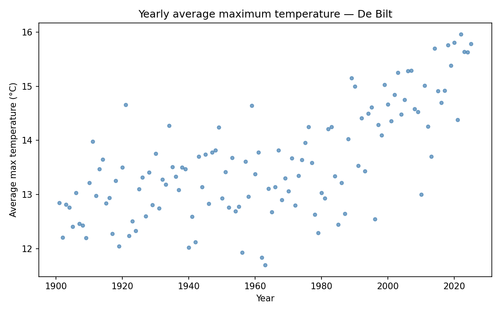
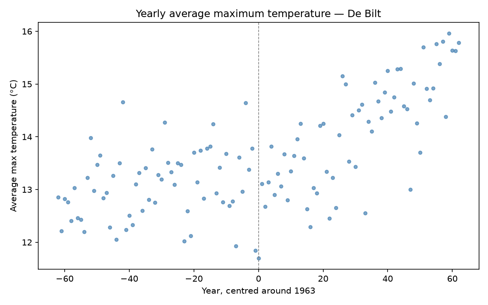

# Centring

In week 6 you fitted a line by hand through the De Bilt temperatures:

{: style="max-width:70%;"}

Now let your `fit` function from Gradient Descent find the best line. Create a file called `centring.py`, copy in `fit` and the functions it uses, and read `yearly_avg_temp.csv` ([download](../read-data/yearly_avg_temp.csv)) into two lists, `years` and `avg_txs`.

Print every result in the same way as in Gradient Descent:

    print(f"w = {w:.6f}")
    print(f"b = {b:.6f}")
    print(f"MSE = {mse_list[-1]:.4f}")

## Part 1: the years as they are

Run:

    w, b, mse_list = fit(years, avg_txs, 0, 0, 10000, 1e-9)

### Expected output

    w = 0.006932
    b = -0.000006
    MSE = 0.7357

That is worse than both lines you tried by hand in Manual Fitting. Try some larger learning rates and more iterations: you won't get much further. The years are large numbers (1901–2025), and gradient descent works badly on large numbers.

## Part 2: centre the years

The fix is to **centre** the years around their mean: from every year we subtract the mean year $$\bar{x}$$.

$$\bar{x} = \frac{1}{N}\sum_{j=1}^{N} x_j = 1963$$

So 1901 becomes $$-62$$, 1963 becomes $$0$$ and 2025 becomes $$62$$. The data stays exactly the same, only the numbers on the x-axis change:

{: style="max-width:70%;"}

Make a list `years_c` with the centred years and run:

    w, b, mse_list = fit(years_c, avg_txs, 0, 0, 10000, 1e-5)

### Expected output

    w = 0.019006
    b = 13.600110
    MSE = 0.5458

## Part 3: back to real years

Centring changes the meaning of the parameters only slightly:

- $$w$$ is still the warming per year: shifting the data sideways does not change the slope.
- $$b$$ is the predicted temperature in 1963, the year where the centred $$x$$ is $$0$$.

So to predict the temperature in a real year, centre it first: for 2050 that is $$\hat{y} = w \cdot (2050 - 1963) + b$$. Print the warming per century and the prediction for 2050, and plot your line on top of the data, with the real years on the x-axis.

### Expected output

    Mean year: 1963
    Warming per century: 1.90°C
    Predicted for 2050: 15.25°C

## Run

    python centring.py

## Checkpy

    checkpy centring
