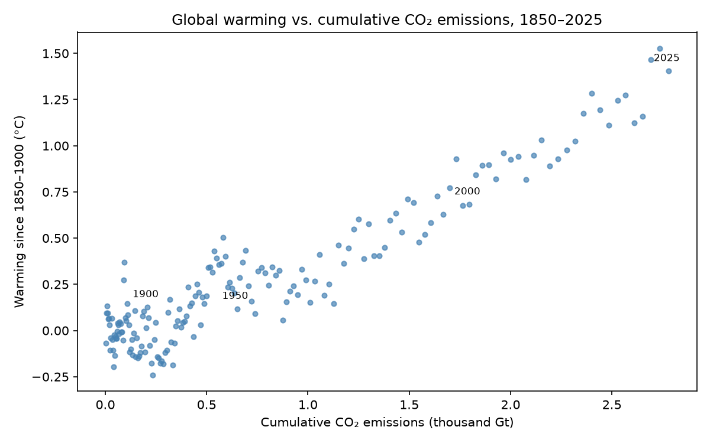

# Gradient Descent

In this assignment you will look at using **gradient descent for linear regression**. Concretely, we will try to find the relation between CO₂ emissions and global warming. We will use data from Our World in Data containing global temperatures and CO₂ emissions from the years 1850 to 2025.

The plot below shows a clear relation between both variables:

{: style="max-width:70%;"}

The points clearly approximate a straight line. We will find that line with linear regression, using gradient descent.

Download the data here: [emissions.csv](emissions.csv)

    year,cumulative_co2,warming
    1850,0.0028,-0.069
    1851,0.0057,0.094
    ...

<small>Sources: Global Carbon Budget and HadCRUT5 (Met Office Hadley Centre), via [Our World in Data](https://ourworldindata.org/co2-and-greenhouse-gas-emissions). The warming is relative to the 1850–1900 average.</small>

## The model

As in the lecture, we model the warming $$\hat{y}$$ for total emissions $$x$$ as:

$$\hat{y} = wx + b$$

where $$w$$ (weight) is the slope and $$b$$ (bias) is the intercept. Both are scalars. Here $$w$$ is the warming per thousand gigatonnes of CO₂.

In practice we express the regression in terms of vectors as we want to make predictions for multiple $$x$$ values at once. Given the $$\vec{x}$$ vector, $$\hat{\vec{y}}$$ is defined by applying the affine function to all elements of $$\vec{x}$$:

$$
\hat{\vec{y}} =
\begin{pmatrix}
w \cdot x_1 + b \\
w \cdot x_2 + b \\
\vdots \\
w \cdot x_N + b
\end{pmatrix}
$$

## The loss

The loss is the squared error loss function that you know from the lecture. On the left in sum notation, on the right the same thing in vector notation:

| sum | vector |
|---|---|
| $$\mathrm{Loss} = \frac{1}{2}\sum_{j=1}^{N}(y_j - \hat{y}_j)^2$$ | $$\mathrm{Loss} = \frac{1}{2}\,(\vec{y} - \hat{\vec{y}}) \cdot (\vec{y} - \hat{\vec{y}})$$ |

where $$\hat{y}_j = wx_j + b$$, and $$\hat{\vec{y}}$$ is what `apply_affine` returns.

## The gradients

To minimize the loss, we need its partial derivatives with respect to $$w$$ and $$b$$. 

| sum | vector |
|---|---|
| $$\frac{\partial\,\mathrm{Loss}}{\partial w} = -\sum_{j=1}^{N}(y_j - \hat{y}_j)\,x_j$$ | $$\frac{\partial\,\mathrm{Loss}}{\partial w} = -(\vec{y} - \hat{\vec{y}}) \cdot \vec{x}$$ |
| $$\frac{\partial\,\mathrm{Loss}}{\partial b} = -\sum_{j=1}^{N}(y_j - \hat{y}_j)$$ | $$\frac{\partial\,\mathrm{Loss}}{\partial b} = -(\vec{y} - \hat{\vec{y}}) \cdot \vec{1}$$ |

(for the vector notation, $$\vec{1}$$ is a vector of ones with $$N$$ elements)

> Both $$\frac{\partial\,\mathrm{Loss}}{\partial w}$$ and $$\frac{\partial\,\mathrm{Loss}}{\partial b}$$ are **scalars**, single values. What these partial derivatives tell us is how much the loss will *increase* if we slightly increase the respective parameter. For example, if $$\frac{\partial\,\mathrm{Loss}}{\partial w} = 7$$, that means that if we increase $$w$$ by a small amount (e.g., $$0.01$$) then the loss will *increase* by 7 times that small amount ($$0.07$$).

## The update step

At each iteration, we slightly change $$w$$ and $$b$$ in the direction that reduces the loss:

$$w := w - \alpha \frac{\partial\,\mathrm{Loss}}{\partial w}$$

$$b := b - \alpha \frac{\partial\,\mathrm{Loss}}{\partial b}$$

where $$\alpha$$ is the **learning rate**. This is a small positive number that controls by how much we want to change the values.

## Part 1

Create a file called `gradient_descent.py`. Read `emissions.csv` into two lists, `emissions` and `warming`, and copy the following functions over from week 5:

- `apply_affine`
- `vector_diff`
- `inner_product`
- `mse`
- `plot_regression`: change the axis labels to fit this data. The rest of the functions can be kept as they are.

Implement the following function:

    def visualize_learning(xs, ys, w_start, b_start, learning_rate):
        ...
    
    visualize_learning(emissions, warming, 0, 0, 0.001)

It should run three steps of gradient descent and show a plot of the regression line at each step. The algorithm should follow this structure:

1. Set `w = w_start` and `b = b_start`.
2. Repeat three times:
    1. Compute the MSE of the current line: `mse(apply_affine(xs, w, b), ys)`.
    2. Call `plot_regression` with `xs`, `ys`, `w`, `b` and the MSE, and show the plot with `plt.show()`.
    3. Update `w` and `b` as described in the update step above (using the learning rate and the partial derivatives):

           w = ...
           b = ...

If you implemented the update step correctly, each plot shows a better regression line, and therefore a lower MSE. The titles should read `MSE = 0.2445`, `MSE = 0.1379` and `MSE = 0.0889`.

## Part 2

Once you have confirmed that your algorithm above seems to work as expected, you're ready to do a full run.

Then implement the following function:

    def fit(xs, ys, w_start, b_start, n_iterations, learning_rate):
        ...
        return w, b, mse_list

The function runs gradient descent on the data `xs` and `ys` for `n_iterations` steps, starting from `w_start` and `b_start`. It should run the same algorithm as above, but for `n_iterations` instead of three and *without* the plotting (that gets a bit annoying after a few iterations). The function returns the final $$w$$, the final $$b$$, and a list with the MSE after every step: after updating $$w$$ and $$b$$, compute the MSE of the new line and append it.

### Run

Call the function with:

    w, b, mse_list = fit(emissions, warming, 0, 0, 50, 1e-4)

Print the result:

    print(f"w = {w:.6f}")
    print(f"b = {b:.6f}")
    print(f"MSE = {mse_list[-1]:.4f}")

### Expected output

    w = 0.250811
    b = 0.096327
    MSE = 0.0496

This is not the best possible result. Fifty iterations at this learning rate are not enough to fully converge. You will fix that in Part 3.

## Part 3: Visualize learning and improve results

Plot the final regression line with `plot_regression` (use the last MSE in `mse_list`), and plot `mse_list` in a second figure, to show how the MSE decreased over the iterations.

Try to improve the results. Copy the line `w, b, mse_list = fit(emissions, warming, 0, 0, ..., ...)` and find a combination of learning rate and number of iterations that converges to an MSE of `0.0167`. Print the result in the same way as in Part 2, and make the same two plots for this run. Keep Part 2 in your file as well: checkpy checks both runs.

### Hints

- A larger learning rate converges faster, but may overshoot and diverge. If you get `nan` or huge numbers, your learning rate is too large.
- Increase the learning rate first, then adjust the number of iterations until the MSE curve has clearly flattened out.

## Run

    python gradient_descent.py

## Checkpy

    checkpy gradient_descent
