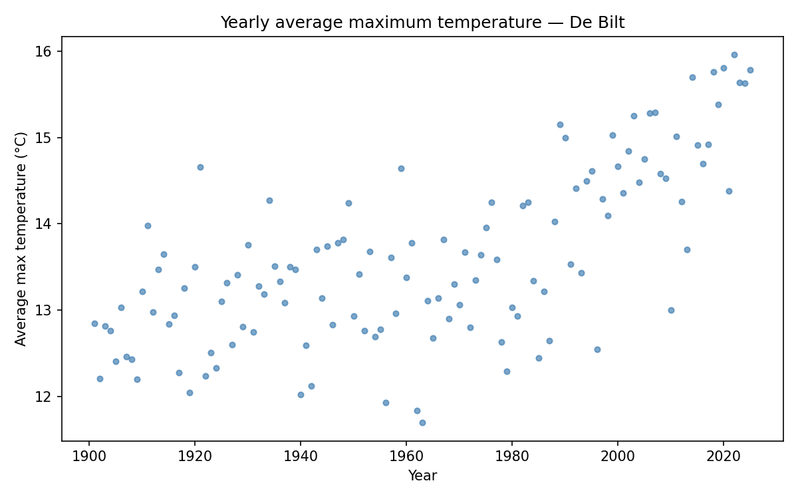
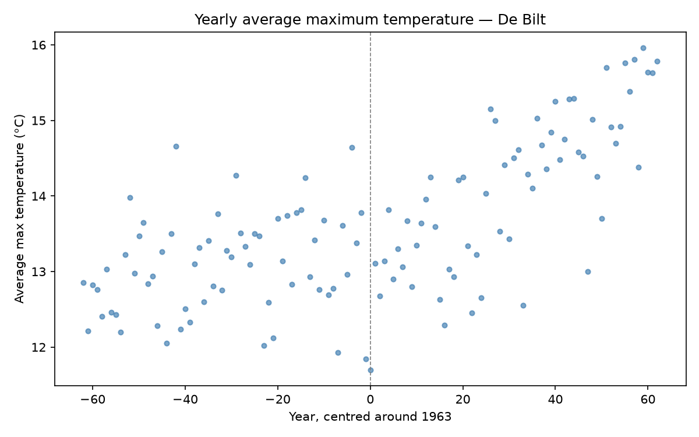

# Gradient Descent

We have data on yearly average maximum temperatures measured at De Bilt, from 1901 to 2025:

{: style="max-width:70%;"}

We want to find the straight line that best fits this data — the line that minimises the total prediction error. Finding that line is called **linear regression**, and we will solve it using **gradient descent**.

## The model

As in the lecture, we model the temperature in year $$x$$ as:

$$\hat{y} = wx + b$$

where $$w$$ (weight) is the slope and $$b$$ (bias) is the intercept. Both are scalars.

## Centring the years

Gradient descent works badly when the inputs are large numbers like 1901–2025. So before we start, we **centre** the years around their mean: from every year we subtract the mean year $$\bar{x}$$.

$$\bar{x} = \frac{1}{N}\sum_{j=1}^{N} x_j = 1963$$

So 1901 becomes $$-62$$, 1963 becomes $$0$$ and 2025 becomes $$62$$. The data stays exactly the same, only the numbers on the x-axis change:

{: style="max-width:70%;"}

From here on, $$x_j$$ is a centred year. This changes the meaning of the parameters only slightly:

- $$w$$ is still the warming per year: shifting the data sideways does not change the slope.
- $$b$$ is the predicted temperature in 1963, the year where the centred $$x$$ is $$0$$.

To predict the temperature in a real year, centre it first: for 2030 that is $$\hat{y} = w \cdot (2030 - 1963) + b$$.

## The loss

The loss is the squared error loss function from the lecture. On the left in sum notation, on the right the same thing in vector notation:

| sum | vector |
|---|---|
| $$\mathrm{Loss} = \frac{1}{2}\sum_{j=1}^{N}(y_j - \hat{y}_j)^2$$ | $$\mathrm{Loss} = \frac{1}{2}\,(\vec{y} - \hat{\vec{y}}) \cdot (\vec{y} - \hat{\vec{y}})$$ |

where $$\hat{y}_j = wx_j + b$$, and $$\hat{\vec{y}}$$ is what `apply_affine` returns.

## The gradients

To minimise the loss, we need its partial derivatives with respect to $$w$$ and $$b$$. Both are **scalars**:

| sum | vector |
|---|---|
| $$\frac{\partial\,\mathrm{Loss}}{\partial w} = -\sum_{j=1}^{N}(y_j - \hat{y}_j)\,x_j$$ | $$\frac{\partial\,\mathrm{Loss}}{\partial w} = -(\vec{y} - \hat{\vec{y}}) \cdot \vec{x}$$ |
| $$\frac{\partial\,\mathrm{Loss}}{\partial b} = -\sum_{j=1}^{N}(y_j - \hat{y}_j)$$ | $$\frac{\partial\,\mathrm{Loss}}{\partial b} = -(\vec{y} - \hat{\vec{y}}) \cdot \vec{1}$$ |

where $$\vec{1}$$ is a vector of ones with $$N$$ elements. The vector column translates directly into your functions from week 5.

## The update step

At each iteration, we nudge $$w$$ and $$b$$ in the direction that reduces the loss:

$$w := w - \alpha \frac{\partial\,\mathrm{Loss}}{\partial w}$$

$$b := b - \alpha \frac{\partial\,\mathrm{Loss}}{\partial b}$$

where $$\alpha$$ is the **learning rate** — a small positive number that controls the step size.

## Assignment

Create a file called `gradient_descent.py`. Read `yearly_avg_temp.csv`, centre the years, and copy in your `apply_affine`, `vector_diff`, `inner_product`, and `mse` functions from week 5.

Then implement the following function:

    def fit(w_start, b_start, n_iterations, learning_rate):
        ...
        return w, b, mse_list

The function runs gradient descent for `n_iterations` steps starting from `w_start` and `b_start`. It returns the final $$w$$, the final $$b$$, and a list with the MSE after every step: after updating $$w$$ and $$b$$, compute the MSE of the new line and append it.

> Gradient descent minimises the loss above, but we follow its progress with the MSE from week 5, so you can compare it with your results from Manual Fitting. Both are the same sum, the MSE divided by $$N$$ instead of by $$2$$, so they are smallest for the same $$w$$ and $$b$$.

### Part 1: first run

Call the function with:

    w, b, mse_list = fit(0, 0, 1000, 1e-6)

Print the result:

    print(f"w = {w:.6f}")
    print(f"b = {b:.6f}")
    print(f"MSE = {mse_list[-1]:.4f}")

### Expected output

    w = 0.019006
    b = 1.598155
    MSE = 144.5939

This is only a partial result — 1000 iterations at this learning rate is not enough to fully converge. You will fix that in the next assignment.

### Part 2: plot

Plot the fitted line on top of the scatter data, and plot the `mse_list` as a second figure showing how the loss decreased over the iterations.

Use the real years on the x-axis of the first plot: compute the predictions with the centred years, but plot them against the real ones.

## Run

    python gradient_descent.py

## Checkpy

    checkpy gradient_descent
