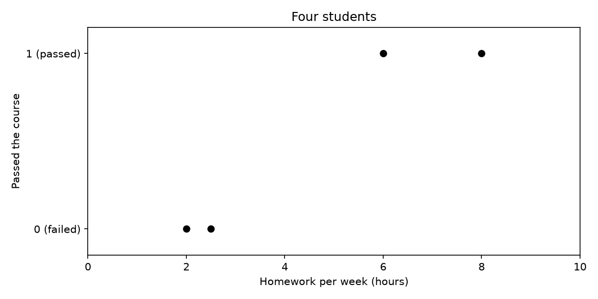

# Logistic Regression

Gradient descent can do more than fit straight lines. In this challenge you use it for **classification**, with the example from the week 3 homework: four students, how many hours of homework they did per week, and whether they passed the course.

| student | homework per week (hours), $$x$$ | passed, $$y$$ |
|---:|---:|---:|
| 1 | 2 | 0 |
| 2 | 2.5 | 0 |
| 3 | 6 | 1 |
| 4 | 8 | 1 |

{: style="max-width:70%;"}

## The model

As in the lecture, the model puts a linear function through the **sigmoid** function:

$$\hat{y} = \sigma(z) = \frac{1}{1+e^{-z}}, \qquad z = wx + b$$

$$\hat{y}$$ is the predicted probability that a student passes. The **decision boundary** lies where $$z = 0$$, at $$x = -\frac{b}{w}$$ hours.

## The loss and the gradients

The loss is the same squared error loss as in Gradient Descent, only with the sigmoid in $$\hat{y}_j$$. The gradients get one extra factor, $$\hat{y}_j(1-\hat{y}_j)$$, the derivative of the sigmoid. In the vector column, $$\vec{d}$$ is the vector with elements $$d_j = (\hat{y}_j - y_j)\,\hat{y}_j\,(1-\hat{y}_j)$$:

| sum | vector |
|---|---|
| $$\mathrm{Loss} = \frac{1}{2}\sum_{j=1}^{N}(y_j - \hat{y}_j)^2$$ | $$\mathrm{Loss} = \frac{1}{2}\,(\vec{y} - \hat{\vec{y}}) \cdot (\vec{y} - \hat{\vec{y}})$$ |
| $$\frac{\partial\,\mathrm{Loss}}{\partial w} = \sum_{j=1}^{N}(\hat{y}_j - y_j)\,\hat{y}_j(1-\hat{y}_j)\,x_j$$ | $$\frac{\partial\,\mathrm{Loss}}{\partial w} = \vec{d} \cdot \vec{x}$$ |
| $$\frac{\partial\,\mathrm{Loss}}{\partial b} = \sum_{j=1}^{N}(\hat{y}_j - y_j)\,\hat{y}_j(1-\hat{y}_j)$$ | $$\frac{\partial\,\mathrm{Loss}}{\partial b} = \vec{d} \cdot \vec{1}$$ |

The update step is the same as before: $$w := w - \alpha \frac{\partial\,\mathrm{Loss}}{\partial w}$$ and $$b := b - \alpha \frac{\partial\,\mathrm{Loss}}{\partial b}$$.

## Assignment

Create a file called `logistic.py` with the lists

    hours = [2.0, 2.5, 6.0, 8.0]
    passed = [0, 0, 1, 1]

and the following functions:

- `sigmoid(z)` — returns $$\sigma(z)$$. Use `math.exp()` for $$e^{-z}$$.
- `predict(xs, w, b)` — returns a list with $$\hat{y}$$ for every $$x$$ in `xs`.
- `loss(predictions, targets)` — returns the loss.
- `fit(xs, ys, w_start, b_start, n_iterations, learning_rate)` — runs gradient descent and returns `w, b, loss_list`, with the loss after every step.

### Part 1: train the model

Run:

    w, b, loss_list = fit(hours, passed, 0, 0, 1000, 1)
    print(f"w = {w:.6f}")
    print(f"b = {b:.6f}")
    print(f"Loss = {loss_list[-1]:.6f}")
    print(f"Decision boundary: {-b / w:.2f} hours")

### Expected output

    w = 1.857401
    b = -7.709851
    Loss = 0.001642
    Decision boundary: 4.15 hours

### Part 2: plot

Plot the four students as points, the sigmoid curve of your model from 0 to 10 hours, and the decision boundary as a vertical line (`plt.axvline()`).

### Part 3: a large learning rate

Run `fit` again, now with a learning rate of `10`, and print the result.

### Expected output

    w = 11.874999
    b = -0.000000
    Loss = 1.000000

The model now predicts that every student passes, and more iterations don't change that. Look at $$w$$, $$b$$ and the gradients after the first step, and explain in a comment at the bottom of `logistic.py` why gradient descent gets stuck.

## Run

    python logistic.py

## Checkpy

    checkpy logistic
