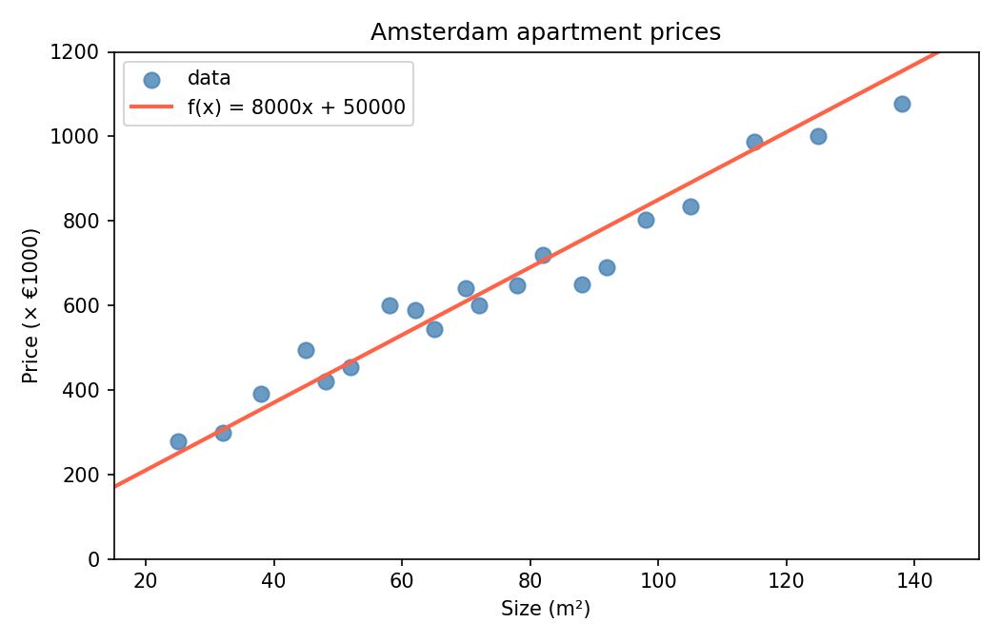

# Plot Regression

In the apply affine assignment, we showed this plot:

{: style="max-width:60%;"}

Your job is to create a similar plot, but using the data from the MSE assignment:

    sizes  = [30.0, 45.0, 60.0, 75.0, 90.0, 120.0]
    actual = [280000.0, 400000.0, 540000.0, 660000.0, 760000.0, 1020000.0]

And the model we found earlier: $$w = 8000$$, $$b = 50000$$.

To keep the numbers on the y-axis readable, we work with prices in thousands of euros: divide every price by 1000. The model then becomes $$w = 8$$, $$b = 50$$. A 60 m² apartment still costs $$8 \cdot 60 + 50 = 530$$ thousand euros.

## Assignment

Create a file called `plot_regression.py` and define the following function:

    def plot_regression(xs, ys, w, b, mse_value):
        ...

It draws and shows a plot with:

* the data `xs` and `ys` as a scatter plot, labelled `data`
* the line $$f(x) = wx + b$$, computed with your `apply_affine` function and labelled with the model, for example `f(x) = 8x + 50`
* a legend
* the MSE as the title, with four decimals, for example `MSE = 100.0000`
* the axis labels `Size (m²)` and `Price (× €1000)`

The function ends by showing the plot with `plt.show()`.

Then use it for the apartments: compute the MSE of the model with your `mse` function and call `plot_regression`. The title should read `MSE = 100.0000`.

## Hints

* Use `plt.scatter(x, y)` for the data points, `plt.plot(x, y)` for the line and `plt.title()` for the title.
* Checkpy cannot judge whether your graph looks correct (but *you* can 😊).

## Run

    python plot_regression.py

## Checkpy

    checkpy plot_regression
